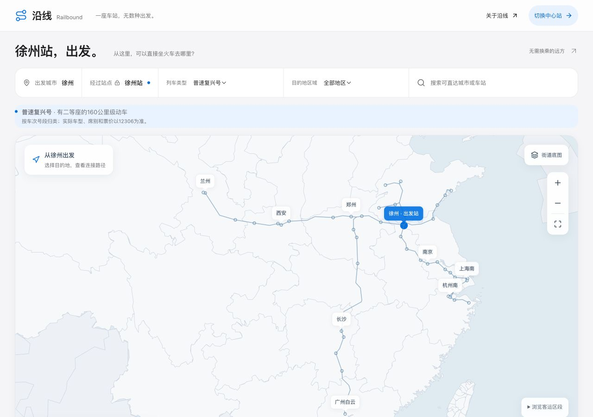

# 沿线 · Railbound

**从一座车站，看见无需换乘的远方。**

沿线是一个以地图为主的中国铁路客运直达网络可视化网站。选择区域、省份、城市和出发车站，就能看到从这里可以直接坐火车到达哪些地方，并按列车类型、目的地区域和站名继续探索。对预算有限的旅行，也可以从普速与普速复兴号中寻找值得进一步比价的出行选择。

项目从徐州和江苏出发，逐步扩展到大陆 31 个省级地区。它关心的是一个简单的问题：**“从这里，能到哪里？”**



*界面示例：徐州站 · 普速复兴号模式。截图基于项目保存的客运数据快照。*

## 项目理念

- **地图优先。** 首页先展示主要站点，选择独立出发站后再展开直达网络。
- **线路可以归并，车站始终独立。** 相近线路共用清楚的绘图走廊，不把不同车站合成一个点或一个出发入口。
- **直达需要客运服务依据。** 两站必须同时出现在一条已接受客运服务的完整停站序列中；地图线段相接不会凭空产生换乘或直达关系。
- **清晰表达“能到”。** 少停站、过夜列车的长距离区间沿已有走廊衔接，避免在远距离停站之间直接拉线。高亮路径用于理解连接，不代表某趟列车逐站经过的实际径路。

## 如何使用

1. 按 **区域 → 省份 → 城市** 选择出发地。
2. 选择主要车站，或打开 **城际铁路**、**市内及周边小站** 子目录，再选一个独立车站。
3. 查看全国直达网络，使用列车类型、目的地区域和城市／站名搜索缩小范围。
4. 点击地图或直达目录中的站点，查看匹配客运服务与连接路径，也可以从该站重新出发。

城市外层地图只显示主要站点；进入子目录后才显示其中的小站。选定出发站后，小站目的地仍参与完整直达网络。地址栏保存当前选择和筛选，复制链接即可分享，刷新也能恢复。

## 已实现功能

| 功能 | 说明 |
| --- | --- |
| 分层选择出发地 | 华北、东北、华东、华中、华南、西南、西北，再分省份、城市和独立车站 |
| 小站归纳 | 城际铁路与市内及周边小站分别组织，主要枢纽保留直接入口 |
| 直达网络地图 | 相近线路归并为共用走廊，支持缩放、站点详情、连接路径高亮 |
| 联动筛选 | 地图、直达目录和统计随列车类型、目的地区域、城市／站名搜索同步更新 |
| 便宜线路探索 | 通过普速与普速复兴号筛选寻找预算出行候选，再到 12306 核对实际票价 |
| 普速复兴号模式 | 单独筛选 CR200J 类动车候选服务，并在车次详情中标记 |
| 分享与恢复 | 通过 URL 查询参数保存出发地、分组和筛选状态 |
| 手机与键盘操作 | 响应式布局、可滚动站点列表、可见焦点与减少动画支持 |
| 访客统计 | 页脚显示不蒜子的累计独立访客数（UV） |
| 数据说明 | 页面内解释来源、绘图方式和使用边界；仓库保留核验与审计记录 |

界面采用冷白背景、系统字体、蓝色选中态和轻量地图浮层。仓库还包含一篇旅行笔记示例，可在 `src/travel/` 中编辑。

### 城际与小站分组

深圳机场等车站收在“城际铁路”内，与深圳北等主要站的入口并列；上海莘庄等市域站则归入“市内及周边小站”。小站不自动等于城际，也不代表它只能到达市内目的地。

目前城际分组覆盖 36 城、27 条线路／运营分段、225 个独立站点；小站分组覆盖 303 城、2,225 个独立站点。城市外层共有 720 个主要快捷入口，2,385 个分类内站点在进入子目录后显示。部分共有枢纽同时提供外层和城际入口，仍指向同一个独立车站。

这些是帮助选站的导航规则，不是官方车站等级。全部 3,105 个已开放出发站均可选择。详见[城际归类](docs/INTERCITY-CLASSIFICATION.md)、[小站归类](docs/SMALL-STATION-CLASSIFICATION.md)和[全城市审计](docs/CITY-CHOICE-AUDIT.md)。

### 便宜线路探索

除了“能到哪里”，沿线也希望帮助预算有限的旅行者发现更多选择：**“不一定追求最快，有没有价格更合适、又能直接到达的车？”**

可以在列车类型中分别查看“普速”和“普速复兴号”，比较它们能直达的城市与车站。后者尤其适合寻找走普速线路、提供二等座的动车候选。这个需求就来自徐州站：传统火车站也有这样的动车服务，希望省钱出行时能方便地把它们找出来。

这里的“便宜线路探索”是帮助发现可比价的候选，**当前没有实时票价、价格排序或最低价计算**，也不保证某类列车在所有区间都更便宜。先在地图上找到适合的直达目的地，再按出行日期、车次和席别到 12306 确认价格。

### 普速复兴号模式

该模式面向提供二等座的 CR200J 系列普速复兴号，适用于所有已收录城市。选择后，地图、搜索、目录、详情和统计沿用原有操作。

现有数据没有逐车次实时车型字段，当前依据车次号段和快照日期推断归类，不能理解为全国车型已经逐趟核验，也不按实时票价判断“最便宜”。当前规则识别到 1,130 个服务记录，涉及 191 城、523 个独立出发站；徐州站对应 57 个直达站点、11 个省级地区。

“高铁 / 动车”包含 G、D、C 类服务，“普速复兴号”是其中可以单独筛选的子集。没有匹配结果时表示当前快照暂无收录，不能据此认定现实中没有开行。规则、来源和排除范围见[普速复兴号说明](docs/SLOW-FUXING-MODE.md)。

## 当前数据范围

以下为仓库所附数据快照的范围，**不是实时全国运行图**。

| 项目 | 当前快照 |
| --- | ---: |
| 覆盖省级地区 | 中国大陆 31 个 |
| 已开放城市／行政单位 | 342 个 |
| 独立出发站 | 3,105 个 |
| 有来源坐标的车站 | 3,193 个 |
| 已接受客运服务记录 | 19,019 个 |
| 已定位停站区间记录 | 156,306 个 |
| 上述区间缺失绘图路径 | 0 个 |
| 尚待核验、未开放的目录入口 | 265 个 |

源时刻表更新日期为 **2026-09-11**，数据整理日期为 **2026-10-10**，轨道快照日期为 **2026-05-10**。服务记录和停站区间可能包含不同方向或来源记录，不等于当天独立开行列车数或去重后的物理铁路区间数。覆盖情况可查阅[逐城市扩展进度](docs/EXPANSION-PROGRESS.md)。

站点、时刻和线路来源分别保存。完整停站序列决定直达关系，地理走廊负责绘图；异常时间、身份冲突、资料不完整等候选被隔离，保留原因与来源。已接受服务中的国内停站坐标已补齐，待开放目录条目仍需继续核验。跨境服务保留完整来源记录，目前地图展示中国境内部分。

## 本地运行

前端使用 **React 19、TypeScript、Vite、Leaflet / React Leaflet、Tailwind CSS 和 Lucide**。铁路快照随项目提供，无须运行项目后端或配置铁路查询 API key。

建议使用 Node.js 24；数据构建和完整测试另需 Python 3.10+。在包含 `package.json` 的项目目录中运行：

```sh
npm ci
npm run dev
```

打开终端显示的本地地址。依赖安装完成后，现有铁路快照可离线构建；获取新的外部数据需要联网。

生成并预览生产版本：

```sh
npm run build
npm run preview
```

构建产物位于 `dist/`，应通过 HTTP 服务预览，不要直接双击其中的 HTML 文件。

## 部署到 GitHub Pages

项目已提供 [GitHub Actions 工作流](.github/workflows/deploy.yml)。

1. 将本项目目录的内容放在 GitHub 仓库根目录，包括 `package.json`、`src/`、`data/` 和隐藏目录 `.github/`，推送到 `main` 分支。
2. 在仓库 **Settings → Pages → Build and deployment → Source** 中选择 **GitHub Actions**。
3. 推送 `main`，或在 **Actions** 中手动运行 **Deploy to GitHub Pages**。
4. 等待构建和部署成功，从仓库 Pages 设置页打开实际生成的网站地址。

工作流依次安装依赖、从已保存快照重新生成数据、运行测试、构建，并发布 `dist/`。若使用其他主分支名称，需要同步修改工作流的分支配置。GitHub 的配置说明见[自定义 Pages 工作流](https://docs.github.com/en/pages/getting-started-with-github-pages/using-custom-workflows-with-github-pages)。

Vite 使用相对资源路径 `base: './'`，支持仓库子目录部署。页面状态使用查询参数，无须额外配置单页路由重写。源码包用于构建；已生成的网站包以 `dist/` 内容为根，可用于静态托管。

## 常用命令

| 命令 | 用途 |
| --- | --- |
| `npm run dev` | 启动本地开发服务 |
| `npm run build` | 严格类型检查并构建生产版本 |
| `npm run preview` | 预览已构建的 `dist/` |
| `npm test` | 运行 Vitest 与 Python 数据检查 |
| `npm run test:e2e` | 运行桌面和手机 Playwright 测试 |
| `npm run data:build` | 从保存的快照离线生成网络、地理数据与审计结果 |
| `npm run data:audit-choices` | 检查所有城市的站点入口、分组及概览地图一致性 |
| `npm run data:audit-fuxing` | 检查普速复兴号规则的快照覆盖 |

首次运行浏览器测试前，安装其浏览器依赖：

```sh
npx playwright install chromium
npm run test:e2e
```

测试涉及同一服务直达、全部已开放出发站的连通、筛选一致性、独立站点身份、来源引用、选站分组和访客数处理。历史实测范围与结果见[验证记录](VERIFICATION.md)。

## 项目结构

```text
.
├── src/
│   ├── components/       # 选站、筛选、详情、数据说明与访客统计
│   ├── map/              # Leaflet 地图与网络显示
│   ├── lib/              # 直达判定、目录索引、绘图与计数逻辑
│   ├── data/             # 前端快照、地理数据和分类规则
│   ├── travel/           # 旅行笔记示例
│   └── types/            # TypeScript 数据类型
├── data/
│   ├── raw/              # 保存的来源快照、采集记录与身份校正依据
│   ├── audit.json        # 数据构建审计
│   └── railway-segments.geojson
├── scripts/              # 数据采集、核验、生成与审计工具
├── tests/                # 单元测试、数据检查与浏览器测试
├── docs/                 # 分类规则、扩展进度、截图及专题说明
├── public/               # 静态资源
└── .github/workflows/    # GitHub Pages 自动构建与部署
```

数据维护可按城市逐步推进。新增站点应有独立身份、可核验坐标和完整客运服务依据；不要用城市中心点代替站址，也不要用轨道相接推导直达。修改快照或分类规则后，运行对应生成、审计与测试命令。详细流程见[维护与接班说明](HANDOFF.md)。

## 外部服务与隐私

默认底图和铁路数据随网站本地读取。“街道底图”由用户主动开启后请求 OpenStreetMap 公共瓦片。

正式 HTTPS 域名会请求不蒜子访客统计，页脚显示 **累计访客数（UV）**。重复访问按服务规则去重；站内切换城市和筛选不会重复发送请求，本地预览不计入。统计请求只发送站点来源域名，不包含地址栏中的车站、城市或搜索条件；服务方仍会收到网络请求中的 IP 与浏览器信息。

UV 不等于严格设备数量，不承诺同设备永久或每天只计算一次。同一个 GitHub Pages 域名下的其他项目可能共用总数，统计不可用时会显示提示。完整口径见[访客统计说明](docs/VISIT-COUNTER.md)。

## 已知限制

- **不是实时购票工具。** 不提供实时余票、票价或开行确认，出行以铁路 12306 为准。
- **收录范围仍在扩展。** 31 个省级地区的入口覆盖不等于全部现行车次、城际线路和车站均已收录。
- **地图线形经过简化。** 共用走廊、高亮路径和示意衔接表达可达关系，不用于逐车次运行径路或精确轨道导航。
- **首次展开网络有加载成本。** 首页先加载概览，完整网络按需加载；当前生产网络块约 53.7 MB，gzip 约 9.15 MB，后续可进一步拆分。
- **统计依赖第三方服务。** 浏览器拦截和网络故障可能导致漏计，未接入前的历史访问无法补回。

## 数据来源与许可

| 来源 | 用途与许可说明 |
| --- | --- |
| [铁路网 / CRECC](https://www.crecc.com/jiangsu/) | 第三方公开车站目录、时刻与完整停站资料；保存来源链接、日期、哈希及事实摘要 |
| [OpenStreetMap / HOTOSM / HDX](https://data.humdata.org/dataset/hotosm_chn_railways) | 铁路走廊与车站地理数据；© OpenStreetMap contributors，适用 [ODbL 1.0](https://opendatacommons.org/licenses/odbl/1-0/) |
| [Wikidata](https://www.wikidata.org/) | 辅助结构化车站坐标，CC0；使用前核对站点身份 |
| [Natural Earth](https://www.naturalearthdata.com/) | 公共领域行政区底图 |
| [railroutes 中国包](https://github.com/mayurrawte/railroutes/tree/main/packages/china)、[车站坐标补充](https://github.com/listenzcc/China-rail-way-stations-data) | 辅助坐标资料，实际使用来源保存在站点记录中 |

政府及铁路相关公开资料用于车站身份、更名和线路归类核验，具体证据保存在数据记录与专题文档中。每个站点的 `coordinateSource` 和线路来源登记可追溯。

软件代码采用 [MIT License](LICENSE)。第三方数据与资源保留各自许可；OSM 轨道 GeoJSON、`physical-rails.json` 及关联衍生数据库按 ODbL 提供，不因软件代码采用 MIT 而改变数据许可。
